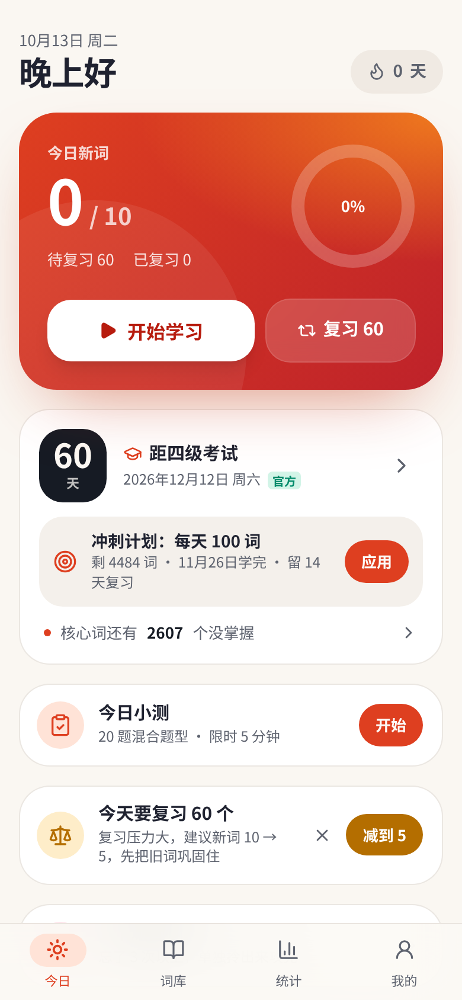
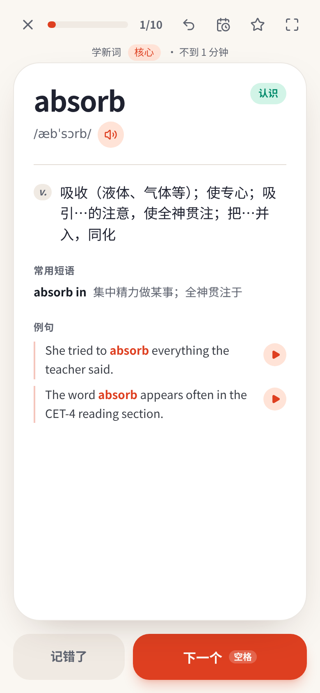
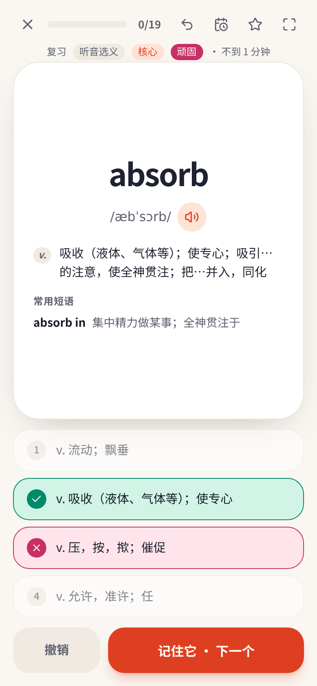
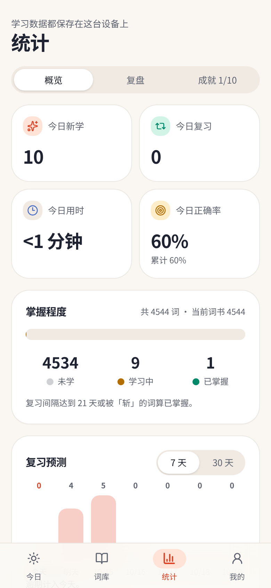
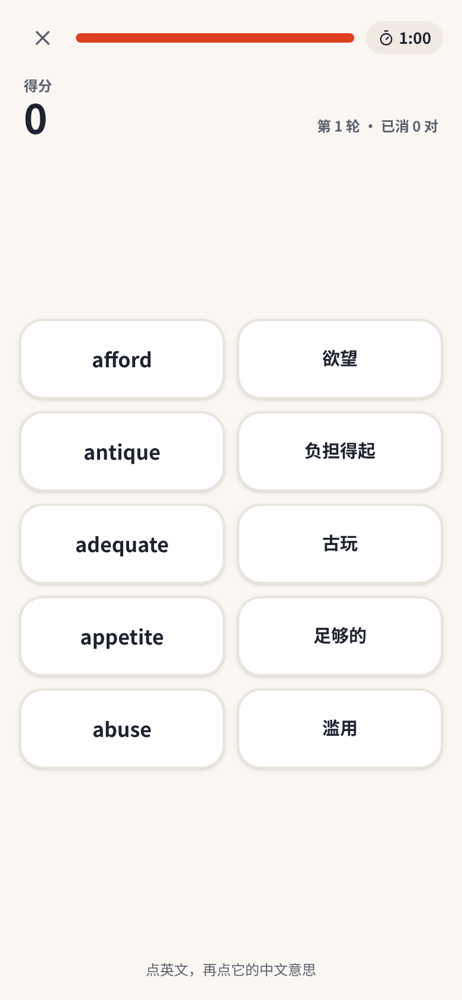
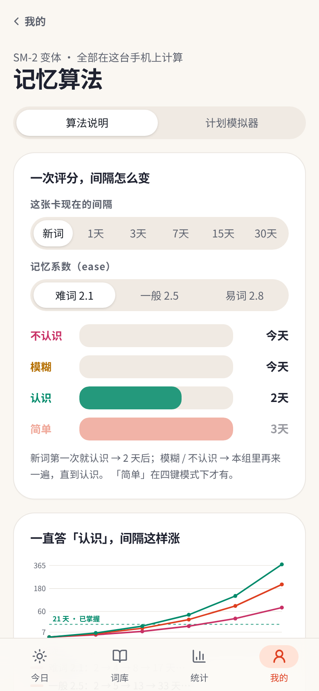

# 四级单词打卡

免费、无广告、不用注册、离线可用的 **CET-4 背单词 PWA**。为用安卓手机（vivo / 小米 / 华为的系统浏览器或 Chrome）备考四级的大学生做的：按考试日期排好每天学多少，10 词一组学新词，忘了的词自动回来、记住的越隔越久，每天打卡，一切数据只存在你自己的手机上。

- 4544 个四级词（2607 个核心词），音标、释义、常用短语全部离线
- 记忆算法可解释：按钮上直接显示「认识 → 3 天后」，有算法说明页和 30 天计划模拟器
- 11 种复习题型、磁带模式、模拟小测、配对消消乐，没有任何拼写 / 打字练习
- 没有后端、没有账号、没有云：备份、合并、加密、快照、多档案全部在本机完成

作者 **Q1f730**

<p>
  
  
  
  
</p>
<p>
  
  
  
  
</p>

## 功能一览

**v1 · 基础**：10 词一组 + 组内重学、SM-2 变体、斩（永久掌握）、四种复习题型（回想 / 英选中 / 中选英 / 听音选义）、词书与每日新词计划、词汇量测试、打卡 + 热力图 + 分享图、生词本 / 错词本 / 熟词、词库搜索与详情、深色模式、键盘快捷键、离线 service worker + 发音缓存、在线例句。

**v2 · 复习更聪明**：评分按钮上的间隔预览、本组错词再练、提前复习、每日复习上限、明天再说（搁置）、形近词辨析、顽固词、短语选义题、震动反馈、持久化存储与备份提醒。

**v3 · 碎片时间与听力**：磁带模式（英文 → 停顿 → 中文连播）、播放范围、锁屏 / 耳机控制（Media Session）、屏幕常亮、发音语速、重复遍数、定时停止、速刷、听音辨词、朗读例句。

**v4 · 四级备考冲刺**：考试倒计时、冲刺计划、模拟小测（20 题限时）、错题回顾、小测历史、一词多义、词性判断、短语挖空、核心未掌握清单、今日小测提醒。

**v5 · 词库与词单**：自定义词单、词单学习、批量操作、A–Z 索引、多种排序、词性筛选、仅看核心词、导出 CSV / Anki、打印词单。

**v6 · 统计与复盘**：复习日志、单词记忆轨迹、保持率曲线、学习时段、周报、月历、难词榜、间隔分布、30 天预测、成就徽章。

**v7 · 坚持与打卡**：补卡、休息日、时长目标、学习提醒、应用角标、系统分享（微信 / QQ）、三款分享图、里程碑庆祝、断签预警、当日回看。

**v8 · 体验与无障碍**：安装引导、字号、左手模式、滑动方向交换、专注模式、高对比度主题（≥ 7:1）、减少动画、读屏播报、正面音标开关、剩余时间估算。

**v9 · 更多玩法**：配对消消乐、判断对错、同义词组、同根形词、新词预习、学后速测、例句选词、自选题型、难度递进、中选短语。

**v10 · 算法进阶**：记忆保持目标（85 / 90 / 95%）、间隔随机扰动、负荷均衡、逾期加成、新词自适应、重学步骤、四键模式（「简单」）、初始难度拟合、算法说明页、计划模拟器。新安装默认打开扰动、均衡、逾期加成、重学步骤和初始难度拟合。

**v11 · 数据与多设备（无云）**：合并导入（两台设备的记录按最近复习合并）、每日自动快照（保留 7 份，可回滚）、加密备份（AES-GCM + PBKDF2）、学习报告长图、从 CSV / TXT 导入词表、数据体检与修复、存储管理、多学习档案、词单链接（编码在链接里，不经服务器）、剪贴板备份。

完整路线图见 [docs/roadmap.md](docs/roadmap.md)，每个版本的细节见 [docs/CHANGELOG.md](docs/CHANGELOG.md)。

## 本地开发

需要 Node.js 20+ 和 pnpm（与 CI 一致用 pnpm 12；`pnpm-workspace.yaml` 里放行了 esbuild 的安装脚本）。

```bash
pnpm install
pnpm dev          # 开发服务器 http://localhost:3015
pnpm test         # vitest 单元测试（src/lib/*.test.ts）
pnpm typecheck    # tsc --noEmit
pnpm build        # 类型检查 + 构建到 dist/（含 sw.js、data/cet4.json）
pnpm preview      # 本地预览构建产物 http://localhost:3015
```

调试：地址后加 `?debugDays=N` 把应用时钟往后拨 N 天（例如 `http://localhost:3015/?debugDays=1#/`）。

技术栈：React 19 + TypeScript + Vite 7 + Tailwind CSS 4 + TanStack Router（文件路由，按页自动分包）+ shadcn/ui。首屏 JS（gzip）约 190 KB，词库 JSON 运行时加载、不打进 JS。

目录：

- `src/lib/` 纯逻辑：`srs.ts` 记忆算法，`algo.ts` 算法进阶，`plan.ts` 每日任务与出题，`stats.ts` 统计，`sync.ts` 合并 / 加密 / 体检 / 词表 / 词单链接，`store.ts` 本地状态
- `src/routes/` 页面（今日 / study / words / stats / me / data / algo / tape / quiz / match / judge …）
- `src/sw-template.js` → 构建时生成 `dist/sw.js`（预缓存应用外壳和词库，发音 cache-first）
- `scripts/build-data.py` 重新生成 `public/data/cet4.json`

## 部署（静态托管 / GitHub Pages）

构建产物是纯静态文件，放到任何静态托管（GitHub Pages、Cloudflare Pages、Netlify、对象存储 + CDN）都能用：

- `vite.config.ts` 里 `base: "./"`：所有资源都用相对路径，部署在根目录或任意子路径（如 `https://<用户名>.github.io/engq1f/`）都不用改配置。
- 路由用 hash（`#/words`、`#/stats`），服务器不需要任何重写规则，刷新任何页面都不会 404。
- service worker（`sw.js`）和 `manifest.webmanifest` 都用相对路径注册 / 声明，作用域就是部署目录；子路径部署后同样可以「添加到桌面」并离线使用。
- PWA 需要 HTTPS（`localhost` 除外）；GitHub Pages 默认就是 HTTPS。

### 两个在线站点（13.0.0，账号与数据互不相通）

| 站点 | 构建 | 后端 | 自动发布 |
|---|---|---|---|
| gz58y2647ucx.meoo.run | `BACKEND=supabase pnpm build` | Meoo Cloud（Supabase） | `.github/workflows/meoo-deploy.yml` |
| watercoloreyes.cn | `BACKEND=cloudflare pnpm build` | Cloudflare Pages Functions（`functions/`）+ D1 | Cloudflare Pages 的 Git 集成 |

详见 [docs/cloud.md](docs/cloud.md) 和 [docs/deploy-cloudflare.md](docs/deploy-cloudflare.md)。不登录的话两个站点都一样：记录只存在本机，离线可用。

GitHub Pages 一键部署：仓库已带 [`.github/workflows/pages.yml`](.github/workflows/pages.yml)。在仓库 **Settings → Pages → Build and deployment** 里把 Source 选成 **GitHub Actions**，之后每次推送到 `main` 都会用 pnpm 构建并把 `dist/` 发布到 Pages。

## 数据来源与许可

| 数据 | 来源 | 许可 | 用法 |
|---|---|---|---|
| 词表、释义、短语 | [KyleBing/english-vocabulary](https://github.com/KyleBing/english-vocabulary)（`3-CET4-顺序.json`） | BSD-3-Clause | 合并去重后写进 `public/data/cet4.json` |
| 美音 / 英音音标、核心词标记 | [qwerty-learner](https://github.com/RealKai42/qwerty-learner) 词典数据 | GPL-3.0 | 合并后写进 `public/data/cet4.json` |
| 英文例句 | [Free Dictionary API](https://dictionaryapi.dev/)（api.dictionaryapi.dev） | 在线接口，未随仓库分发 | 联网时按需获取，缓存在浏览器里 |
| 单词发音 | 有道词典 dictvoice 接口 | 在线接口，未随仓库分发 | 联网时播放并缓存；离线时用系统语音 |

**重要：`public/data/cet4.json` 包含来自 qwerty-learner 的 GPL-3.0 音标数据**，随应用一起分发。因此本仓库整体按 **GPL-3.0** 发布（见 [LICENSE](LICENSE)），没有采用 MIT。KyleBing/english-vocabulary 的 BSD-3-Clause 与 GPL-3.0 兼容，其版权声明和许可全文保留在 [data-licenses/](data-licenses/)。

如果你想把代码以更宽松的许可复用：`src/` 下的代码均为本项目原创，去掉 `public/data/cet4.json` 中的音标字段（或换成其他许可的音标数据）后再分发即可，届时请自行确认许可。

## 作者

Q1f730 · 四级单词打卡 v11.0.0 · 欢迎提 issue 和 PR。
